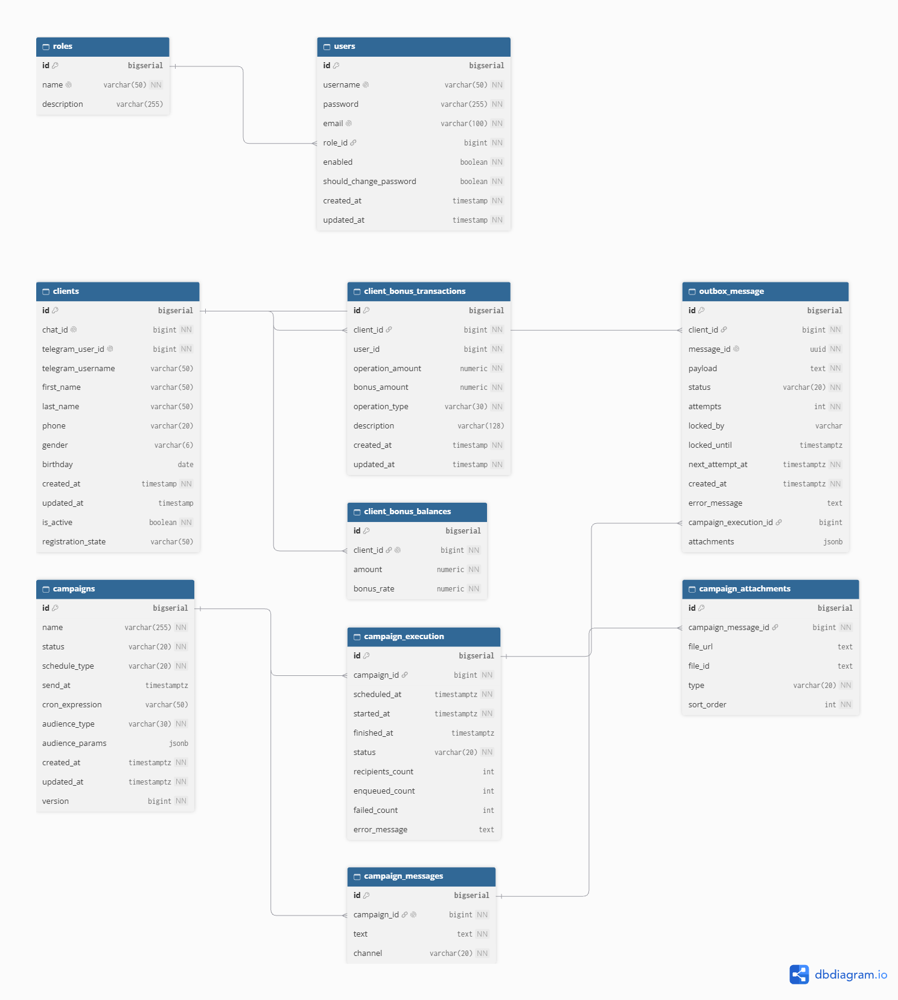

# LoyaltyBot — система лояльности с Telegram-ботом и веб-админкой

Платформа лояльности для бизнеса: клиенты взаимодействуют с программой через Telegram-бота, администраторы управляют бонусами и кампаниями через веб-панель.

## О проекте

LoyaltyBot — учебный/командный проект, реализующий программу лояльности «под ключ». Клиенты регистрируются в Telegram-боте, получают и тратят бонусы, видят историю операций. Администраторы через веб-админку управляют клиентами, правилами начисления бонусов и маркетинговыми кампаниями (разовые и регулярные рассылки по сегментам клиентов).

**Пользователи:**
- **Клиенты** — общаются с ботом в Telegram.
- **Кассиры (`ROLE_USER`)** и **администраторы (`ROLE_ADMIN`)** — работают через веб-админку.

## Функциональность

### Telegram-бот
- Регистрация клиента (пошаговое заполнение профиля: имя, телефон, дата рождения и т.д.)
- Получение рассылок в рамках маркетинговых кампаний
- Уведомления

### Веб-админка
- Аутентификация и авторизация (Spring Security, роли `ROLE_USER` / `ROLE_ADMIN`)
- Управление клиентами (профиль, статус активности)
- Операции с бонусами (начисление/списание с привязкой к кассиру)
- Настройка бонусного процента (`bonus_rate`) для клиента
- Управление маркетинговыми кампаниями: разовые и регулярные (cron), выбор аудитории, тексты и вложения
- История выполнений кампаний со статистикой (получатели, отправлено, ошибки)

## Технологический стек

| Слой | Технологии |
|------|------------|
| Язык | Java 21 |
| Фреймворк | Spring Boot 4.1.0 |
| Web / MVC | Spring Web MVC, Thymeleaf |
| UI | Bootstrap 5.3.8 (WebJars) |
| Безопасность | Spring Security |
| Работа с БД | Spring Data JPA, Spring JDBC |
| БД | PostgreSQL 15 (alpine) |
| Миграции | Liquibase (`db/changelog/changelog-master.yaml`) |
| Telegram | TelegramBots 7.4.2 (long polling) |
| Маппинг | MapStruct 1.6.3 |
| Утилиты | Lombok |
| Сборка | Maven (Maven Wrapper) |
| Контейнеризация БД | Docker Compose |

## Архитектура

Приложение — монолит на Spring Boot, совмещающий Telegram-бота и веб-админку в одном процессе. База данных PostgreSQL запускается отдельно через Docker Compose.

- **Telegram-слой** — long-polling бот (`telegrambots-longpolling`), обрабатывает команды и сообщения клиентов, ведёт регистрацию.
- **Web-слой** — Spring MVC + Thymeleaf, веб-админка под Spring Security (роли `ROLE_USER`/`ROLE_ADMIN`).
- **Сервисный слой** — бизнес-логика бонусов и маркетинговых кампаний.
- **Outbox-слой** — надёжная доставка исходящих сообщений (см. раздел «Outbox»).
- **Слой доступа к данным** — Spring Data JPA + Liquibase-миграции, PostgreSQL.


## Схема базы данных

Управление схемой — через Liquibase (`src/main/resources/db/changelog/changelog-master.yaml`).

**Основные таблицы:**

| Таблица | Назначение |
|---------|------------|
| `clients` | Клиенты бота: `chat_id`, `telegram_user_id`, профиль, статус регистрации (`registration_state`), активность |
| `roles` | Роли пользователей админки: `ROLE_USER` (кассир), `ROLE_ADMIN` |
| `users` | Пользователи админки: логин, пароль (BCrypt), email, роль, флаг смены пароля |
| `client_bonus_transactions` | История операций: сумма операции, начисленные бонусы, тип, кто выполнил (`user_id`), описание |
| `client_bonus_balances` | Текущий баланс бонусов клиента и индивидуальный `bonus_rate` |
| `campaigns` | Маркетинговые кампании: статус, тип расписания (`ONE_TIME`/`RECURRING`), аудитория (JSONB), cron |
| `campaign_execution` | История запусков кампаний: статус, счётчики получателей/отправок/ошибок |
| `campaign_messages` | Текст сообщения кампании и канал |
| `campaign_attachments` | Вложения к сообщению кампании (файл, тип, порядок) |
| `outbox_message` | Очередь исходящих сообщений (Outbox) со статусами, lease и retry |

**Ключевые ограничения и индексы:**
- `campaigns` — CHECK на согласованность расписания (`ONE_TIME` требует `send_at`, `RECURRING` — `cron_expression`).
- `outbox_message` — уникальность `message_id` (UUID) и `(campaign_execution_id, client_id)` для кампанийных сообщений.
- Индексы очереди: `(status, next_attempt_at)` для `NEW`/`FAILED`, `(status, locked_until)` для `PROCESSING`.
- `client_bonus_transactions` — индекс `(client_id, operation_type, created_at)`.



## Outbox

**Проблема.** При изменении баланса бонусов и при рассылках кампаний нужно надёжно отправлять сообщения в Telegram. Прямая отправка внутри транзакции БД ненадёжна: при сбое после коммита сообщение теряется, а при откате — уходит «фантомное» сообщение.

**Решение.** Реализован паттерн Outbox на таблице `outbox_message`:

- сообщение пишется в БД **в той же транзакции**, что и бизнес-изменение;
- отдельный процесс выбирает сообщения в статусах `NEW`/`FAILED` (индекс `(status, next_attempt_at)`), захватывает их через **lease** (`locked_by`, `locked_until`, индекс `(status, locked_until)` для `PROCESSING`);
- отправка через Telegram (`sender.type: telegram`), после успеха — статус меняется, при ошибке — увеличивается `attempts` и рассчитывается `next_attempt_at`;
- **reaper** периодически снимает просроченные lease у зависших сообщений;
- **cleanup** по cron (`0 0 3 * * *`) удаляет старые записи (retention 30 дней).

**Почему так.** Гарантия «хотя бы одной доставки», отсутствие распределённых транзакций, устойчивость к сбоям и повторным попыткам, защита от параллельной обработки одного сообщения.

**Уникальность для кампаний.** Частичный уникальный индекс `(campaign_execution_id, client_id)` гарантирует, что одному клиенту в рамках одного запуска кампании не уйдёт дубль.

**Статус:** реализовано, по умолчанию выключено (`outbox.enabled: false`) — включается конфигурацией.

**Конфигурация (`outbox` в `application.yml`):**
| Параметр | Значение по умолчанию |
|----------|------------------------|
| `enabled` | `false` |
| `batch-size` | `50` |
| `lease-duration` | `2m` |
| `poll-interval` | `5s` |
| `reaper-interval` | `1m` |
| `max-attempts` | `5` |
| `retry.base` / `multiplier` / `max` | `1m` / `2.0` / `1h` |
| `cleanup.cron` / `retentionDays` | `0 0 3 * * *` / `30` |
| `sender.type` | `telegram` |

## Маркетинговые кампании

Модуль кампаний позволяет создавать разовые (`ONE_TIME`, с `send_at`) и регулярные (`RECURRING`, с `cron_expression`) рассылки. Аудитория задаётся типом и параметрами (`audience_type`, `audience_params` JSONB). Каждый запуск фиксируется в `campaign_execution` со статистикой (получатели, поставлено в очередь, ошибки). Сообщения и вложения хранятся в `campaign_messages` и `campaign_attachments`, а постановка в очередь идёт через `outbox_message` (батчами, `campaign.batch-size: 500`, часовой пояс `Europe/Moscow`).

## Запуск локально

### Требования
- JDK 21
- Docker и Docker Compose
- Maven Wrapper уже в репозитории (`./mvnw` / `mvnw.cmd`)

### Планы развития
- Покрытие тестами (unit + integration)
- CI/CD (GitHub Actions)
- Контейнеризация приложения (Dockerfile + сервис в docker-compose)
- Включение Outbox в боевом режиме
- Хранение файлов кампаний в MinIO

### Лицензия
Этот проект распространяется под лицензией MIT. Подробности смотрите в файле LICENSE.

### Шаги

```bash
git clone https://github.com/Artem-doronin/LoyaltyBot.git
cd LoyaltyBot

# 1. Поднять PostgreSQL
docker compose -f docker/docker-compose.yml up -d

# 2. Запустить приложение
./mvnw spring-boot:run

